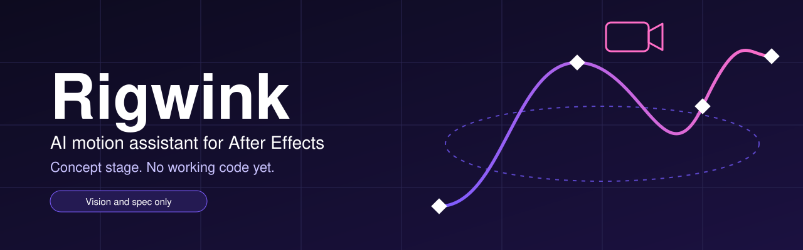

  

> **Status: experimental prototype, never run inside After Effects yet.** The code is covered by 135 Node tests that run against a mock of the After Effects scripting API. The mock checks that API calls are consistent. It does not prove real rendering or behavior in After Effects. The first step is a manual trial in After Effects (see `docs/ESSAI.md`, in French).

# Rigwink

*An AI motion assistant for After Effects.*

## What exists today

- A strict JSON "spec" format describing a comp: layers, keyframes, easing, camera moves (truck, dolly, crane, pedestal, pan, tilt, orbit, whip pan, roll, zoom, parallax, handheld, shake).
- An ExtendScript engine that is meant to turn a spec into editable layers, keyframes and camera rigs.
- A dockable ScriptUI panel and a file bridge (`~/Rigwink-bridge/`) so an outside agent such as Claude Code can read an instruction and write a spec. **This bridge is manual: there is no AI embedded in the panel**, and no API calls.
- Safe parsing: specs are parsed with a strict JSON parser, never with `eval`.

## What does not exist yet

Reference video analysis, automatic review of renders, creative service connectors, and any automatic agent loop. These remain intentions.

---

## Details (French)

Prototype d'assistant motion design pour After Effects : une consigne en
langage naturel devient une spec JSON (via un agent externe, ex. Claude Code,
sans coût API) qu'un script AE applique en vrais calques, keyframes et rig
caméra éditables.

**Statut honnête : prototype, jamais encore exécuté dans After Effects.**
135 tests Node valident la cohérence des appels API contre un mock du DOM AE,
pas le rendu réel. Première étape = essai dans AE (voir docs/ESSAI.md).

## Contenu

- `dist/Rigwink.jsx` — panneau ScriptUI dockable (un seul fichier, tout inclus)
- `dist/Rigwink Run Spec.jsx` — applique une spec JSON sans installer le panneau
- `examples/orbit-text.json` — spec d'exemple prête à l'emploi
- `docs/ESSAI.md` — mode d'emploi du premier essai
- `docs/SPEC.md` — format de la spec, mouvements, règles, limites connues
- `docs/claude-code-bridge.md` — boucle consigne <-> spec par dossier-pont
- `src/`, `test/`, `build.js` — modules, suite de 135 tests, assemblage des bundles

## Sécurité

La spec JSON est parsée strictement (RWJSON), jamais via eval : un fichier
spec ne peut pas exécuter de code.
