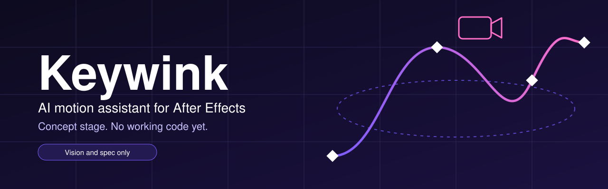

  

> **Status: concept stage.** This repository holds the vision and the written specification only. **There is no working code yet**, and nothing below describes an existing feature.

# Keywink

*An AI motion assistant for After Effects.*

An AI agent that lives in a dockable panel inside Adobe After Effects and aims to help motion designers go from a brief or a reference to an **editable** animation.

It is not meant to be a chatbot that only writes JSX scripts. The goal is an assistant that understands the project it is working in, builds real layers, rigs and keyframes, and leaves the designer in control.

## What it aims to do

| Area | Target |
| --- | --- |
| **Native panel** | A dockable panel in After Effects with its own chat, history and tools. |
| **Motion design** | Animations, transitions, easing curves, typography, rigs. |
| **Camera motion** | Editable camera rigs and moves: orbit, dolly, crane, tracking, parallax, zoom, whip pan. |
| **Reference analysis** | Study a reference video (timing, camera, art direction) to help reproduce or reinterpret it in After Effects. |
| **Review loop** | Look at its own renders, spot defects and propose or apply fixes. |
| **Creative services** | Connect to Claude, and possibly Runway, Luma or Firefly, to generate and import assets. |

## Example of the intended experience

> "Reproduce the camera move from this video, with my logo, a premium look and a smooth ending."

The target flow: read the project and the reference, make a plan, build the rigs, layers and keyframes, render a preview, check the result, correct it, and hand back an animation the designer can edit.

## Roadmap (intentions, not commitments)

1. A panel that takes an instruction and creates a simple editable animation.
2. Camera rigs.
3. Reference video analysis.
4. Automatic review and correction.
5. Connectors to creative services.

None of these steps is done.

## About

Started by Romain Le Roux, freelance AI video creator based in France, with a post-production background. The author intends to open the code once there is something to share. A code license has not been chosen yet.
